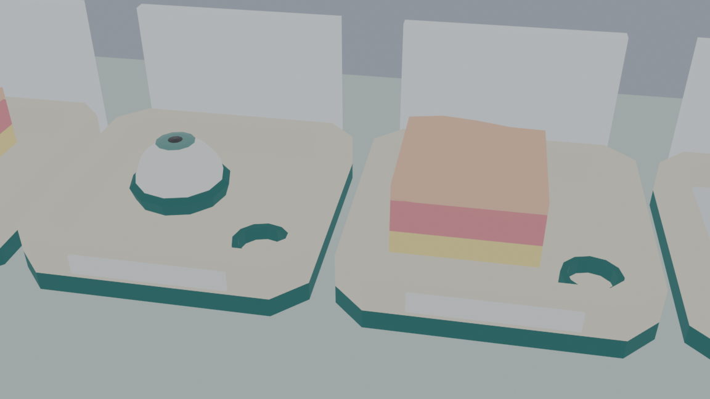

# สถานีทดสอบ 4 Endpoint

ไฟล์ Blender รุ่นสถานีมีถาด 4 ใบและอุปกรณ์ที่เกี่ยวข้องแล้ว เริ่มจาก [ฉากแก้ไขปัจจุบัน](../Room/Current/Lab2_3room_station.blend) หรือดู [ภาพรวมใน Blender](Blender-Previews/overview.png) ก่อน

| สิ่งที่ต้องการ | ภาพ Ref สำหรับปั้น | พรีวิวจากฉาก |
|---|---|---|
| แท่นวางหลอด 4 ช่อง | [Rack](Refs/four-vial-rack.png) | [Rack](Blender-Previews/rack.png) |
| ถาดทดสอบแยก 4 ใบ | [Tray](Refs/endpoint-tray.png) | [Trays](Blender-Previews/trays.png) |
| ชิ้นผิวตัดขวาง | [Skin insert](Refs/skin-cross-section-insert.png) | [จังหวะหยดลงถาดผิว](Blender-Previews/clip_dispense_skin.png) |
| หลอดหยดกับหยดจำลอง | [Dropper](Refs/transfer-dropper.png) | [จังหวะหยด](Blender-Previews/clip_dispense_skin.png) |
| บานตู้เย็นและช่องเก็บ | [Fridge](Refs/fridge-door-and-slots.png) | [ประตูเปิด](Blender-Previews/fridge_bin_open.png) |
| ฝาถังและบานพับ | [Bin](Refs/bin-lid-and-hinge.png) | [ท่าปล่อยหลอด](Blender-Previews/clip_bin_release.png) |

ลำดับที่ออกแบบไว้คือ Formulator ส่งสูตรที่ผสมแล้ว → Analyst หยิบตัวอย่างย่อยจากสูตรรุ่นเดียวกันไปหยดลงถาดที่ตรง Endpoint → แสดงผลของสูตรนั้น → ผู้ใช้เลือกเก็บหรือทิ้งทีละหลอด → เมื่อครบถามว่าจะเปิดฉบับร่างเพื่อปรับสูตรหรือไม่

Endpoint หลัก 4 รายการคือ `skin` ระคายเคืองผิว, `eye` ระคายเคืองตา, `sens` แพ้สัมผัส และ `acute` พิษเฉียบพลัน ให้จับคู่ตัวอย่างกับรหัสผลและสูตรรุ่นที่ถูกต้อง ภาพชิ้นผิวและเอฟเฟกต์เป็นภาพประกอบการคัดกรอง ส่วนข้อมูลที่แสดงต้องอ่านจากผลประเมินที่ผูกกับสูตรนั้น

แนวทางเก็บงานต่ออยู่ใน [PROMPTS-3D](../../Use-Prepared/PROMPTS-3D.md#สถานีทดสอบ-4-endpoint-และแอนิเมชันอุปกรณ์) ให้ยืนยันท่าเปิด–ปิด การหยิบวาง และการคลิกในเว็บแยกจากการตรวจว่าคลิปมีอยู่ในโมเดล

