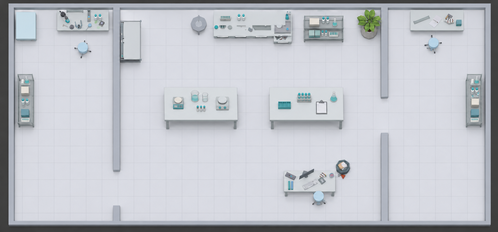

# ห้องแล็บและรุ่นของไฟล์

ห้องกลางกว้างที่สุด เชื่อมห้องซ้ายและขวาผ่านช่องเปิดที่เยื้องกัน ผังปัจจุบันใช้พื้นกระเบื้องลายเดียวกัน มีโต๊ะทดลองกลาง 2 ตัว โต๊ะคอมแยก ต้นไม้ที่มุมขวาบน และสถานี 4 Endpoint

| ไฟล์ | ใช้สำหรับ |
|---|---|
| [Lab2_3room_station.blend](Current/Lab2_3room_station.blend) | ฉากแก้ต่อ มีถาดสถานีและ 4 Actions สำหรับบานตู้เย็นและฝาถัง |
| [Lab_room_3room.glb](Current/Lab_room_3room.glb) | ไฟล์เดียวกับที่เว็บอ้างถึงตอนตรวจ มี 23,511 Tris, 316 mesh primitives, 38 materials, 9 images, 4 clips ขนาด 2.64 MiB |

จำนวน Tris อ่านจาก primitive ใน GLB ที่มีอยู่บนดิสก์ ใช้เทียบขนาด geometry ได้ ส่วนเวลาโหลด, draw calls และความลื่นต้องวัดในเว็บอีกครั้ง

[ผังเปล่า 3 ห้อง](Refs/01-empty-three-room-plan.png) · [ผังปูกระเบื้องพร้อมอุปกรณ์](Refs/02-tiled-furnished-plan.png) · [ผังโต๊ะกลาง 2 ตัว](Refs/03-two-table-plan.png) · [ผนังกระดานและเก้าอี้](Refs/04-wall-boards-and-stools.png)

## เท็กซ์เจอร์สี่ภาพ

| พื้นผิว | ภาพต้นฉบับ | ภาพขนาด 1024 สำหรับเว็บ |
|---|---|---|
| จอคอมกลาง | [Sample Register](Textures/Source/screen_sample_register.png) | [Web](Textures/Web/screen_sample_register_1024.png) |
| กระดานห้องซ้าย | [Formulation Notes](Textures/Source/board_formulation_notes.png) | [Web](Textures/Web/board_formulation_notes_1024.png) |
| กระดานห้องกลาง | [Sample Handoff](Textures/Source/board_sample_handoff.png) | [Web](Textures/Web/board_sample_handoff_1024.png) |
| กระดานห้องขวา | [Demo Results](Textures/Source/board_demo_results.png) | [Web](Textures/Web/board_demo_results_1024.png) |

ไฟล์ Blender ใน Vault ใช้ path สัมพัทธ์ไปยัง `Textures/` หากย้ายไปเครื่องอื่นให้ย้ายทั้งโฟลเดอร์ RalphLab-Plan เพื่อให้พาธยังตรงกัน

